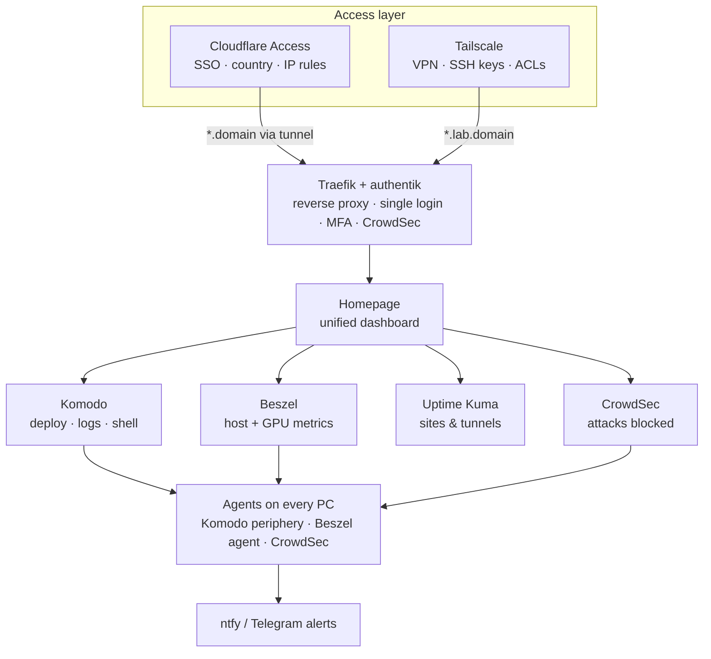

# homelab-ops

One place to run, watch and secure every machine and app in the homelab:
Plex, the local AI API (llama.cpp), the personal website, the family property admin app, and whatever comes next.

**One login, one dashboard, two ways in** (Cloudflare Access from anywhere, or Tailscale VPN), with alerts on your phone.



## What covers what

| Need | Tool | Where |
|---|---|---|
| Apps spread over several machines | Komodo (core + periphery agent per PC) | `core/`, `node/` |
| Deploy / redeploy / manual updates of apps | Komodo stacks from this repo (`git push` → redeploy) | `stacks/`, `komodo/sync.toml` |
| OS updates | unattended-upgrades (security, automatic) + Ansible `update.yml` (manual) | `ansible/` |
| Logs | Komodo (per container), Cockpit (systemd/journal, e.g. llama.cpp) | |
| Health metrics | Beszel: CPU, RAM, disk, network, temps, GPU, per-container | `core/`, `node/` |
| Websites overview | Uptime Kuma (from outside) + Homepage site monitors | `core/`, `offsite/` |
| Security checks | CrowdSec (bans), Trivy (image CVEs), Lynis (host audit) | `ansible/playbooks/audit.yml`, `scripts/` |
| Emergency / dev SSH | Tailscale SSH; Komodo web terminal; Cockpit terminal | `docs/operations.md` |
| Login control | authentik: one login, MFA/passkeys, login history | `core/` |
| IP & region filtering | Cloudflare Access policies + Traefik IP allowlist | `docs/access.md` |
| Notifications | ntfy (+ Telegram), fed by Komodo, Beszel, Uptime Kuma, scripts | `core/` |
| Single view | Homepage with live widgets for all of the above | `core/homepage/` |

## Repository layout

```
core/       Management core: Traefik, authentik, Komodo, Beszel, Uptime Kuma, ntfy, Homepage, CrowdSec, cloudflared
node/       Agents installed on every machine (Komodo periphery, Beszel agent, CrowdSec agent)
offsite/    Uptime Kuma for a VPS outside the house (alerts when the whole house is down)
stacks/     Your apps, one compose file per app, grouped by machine. Deployed by Komodo.
komodo/     Komodo resource sync (which stack runs on which machine)
ansible/    Bootstrap, fleet-wide OS updates, security audit
scripts/    bootstrap-node.sh, gen-secrets.sh, scan-images.sh
docs/       Everything below
```

## Docs

| | |
|---|---|
| [Architecture](docs/architecture.md) | Layers, hostnames, ports, data flows, design decisions |
| [Tools](docs/tools.md) | Every app used, what it does here, links |
| [Access](docs/access.md) | Cloudflare Access (SSO, country, IP), Tailscale, authentik, SSH keys |
| [Deploy the core](docs/deploy.md) | First-time install, step by step |
| [Add a machine](docs/add-machine.md) | New PC/server joins the fleet |
| [Add an app](docs/add-app.md) | New stack on an existing machine, public or private |
| [Dashboard](docs/dashboard.md) | Homepage: layout, widgets, adding tiles |
| [Operations](docs/operations.md) | Updates, logs, emergency SSH, security checks, alerts, backups, runbooks |
| [Local AI / llama.cpp](docs/llama-cpp.md) | How the AI host fits in, and what's custom |

## Quick start

```bash
# On the core host (already on Tailscale):
git clone https://github.com/jaime7981/homelab-ops.git /opt/homelab-ops
cd /opt/homelab-ops/core
cp .env.example .env && cp homepage.env.example homepage.env
../scripts/gen-secrets.sh        # paste into .env
$EDITOR .env
docker compose up -d
```

Then follow [docs/deploy.md](docs/deploy.md) from step 4 onwards.

## Hostnames at a glance

| Service | Public (Cloudflare Access) | Tailnet only |
|---|---|---|
| Dashboard | `dash.DOMAIN` | `dash.lab.DOMAIN` |
| Komodo | `komodo.DOMAIN` | `komodo.lab.DOMAIN` |
| Beszel | `beszel.DOMAIN` | `beszel.lab.DOMAIN` |
| Uptime Kuma | `status.DOMAIN` | `status.lab.DOMAIN` |
| authentik | `auth.DOMAIN` | `auth.lab.DOMAIN` |
| ntfy | `ntfy.DOMAIN` | `ntfy.lab.DOMAIN` |
| Traefik | — | `traefik.lab.DOMAIN` |
| Cockpit (per PC) | — | `https://<machine>:9090` |
